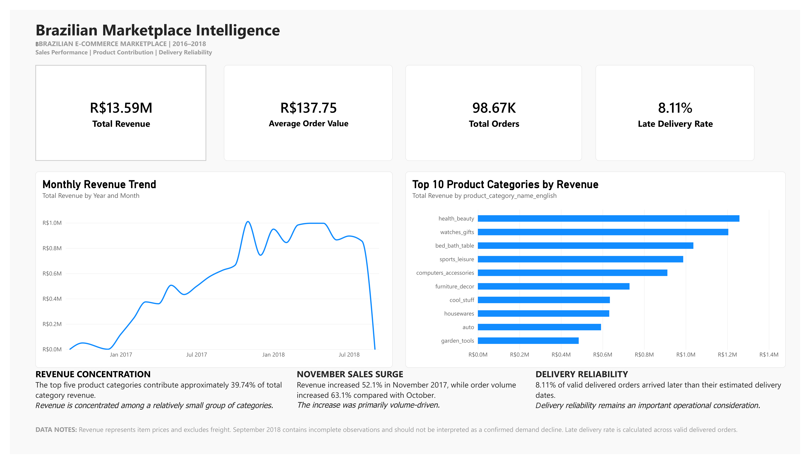
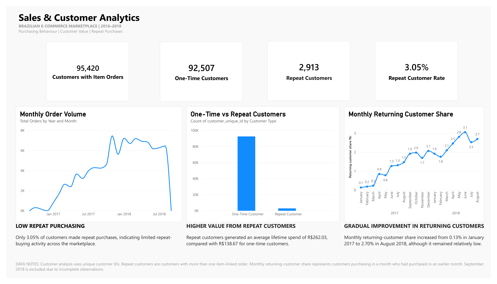
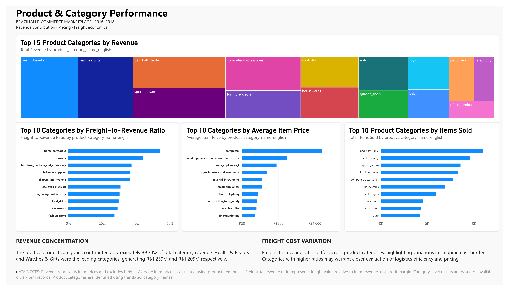
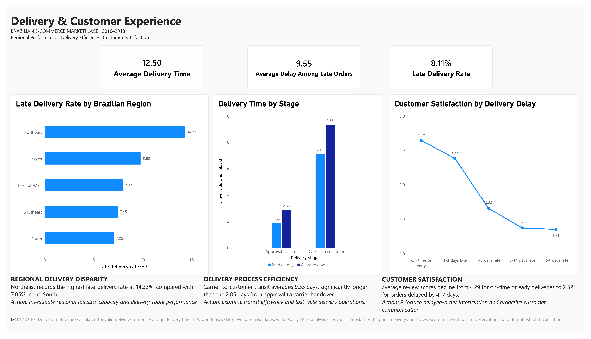

# Brazilian Marketplace Intelligence

An end-to-end data analytics project exploring sales performance, customer behaviour, product trends, delivery operations, and customer satisfaction in the Brazilian e-commerce marketplace.

## Project Overview

This project analyzes the Brazilian E-Commerce Public Dataset by Olist to understand how a multi-seller online marketplace performs across different business dimensions.

Using Python, PostgreSQL, SQL, and Power BI, the project transforms raw transactional data into structured analytical datasets, investigates business performance, and communicates findings through an interactive dashboard.

The analysis focuses on identifying sales patterns, understanding customer purchasing behaviour, evaluating product category performance, examining delivery efficiency, and investigating the relationship between delivery experience and customer reviews.

## Business Objectives

- Analyze overall sales performance, revenue trends, and average order value.
- Understand customer purchasing frequency and repeat-purchase behaviour.
- Identify high-performing product categories and revenue concentration.
- Evaluate delivery performance and regional differences.
- Investigate how delivery delays relate to customer review scores.
- Translate analytical findings into actionable business insights.

## Technology Stack

| Tool | Purpose |
|---|---|
| Python | Data cleaning, preprocessing, and analysis |
| Pandas & NumPy | Data manipulation and numerical analysis |
| Matplotlib & Seaborn | Exploratory data visualization |
| Jupyter Notebook | Dataset auditing and exploration |
| PostgreSQL | Relational data storage and querying |
| SQL | Business analysis and analytical queries |
| Power BI | Interactive dashboards and business reporting |
| Git & GitHub | Version control and project documentation |

## Project Architecture

The project follows a structured analytics workflow:

1. **Data Acquisition:** Obtain the raw Brazilian e-commerce dataset.
2. **Data Auditing:** Inspect data dimensions, data types, missing values, duplicates, and relationships.
3. **Data Cleaning:** Prepare and validate the datasets for analysis.
4. **Database Integration:** Load the cleaned datasets into PostgreSQL.
5. **SQL Analysis:** Perform business-focused analysis across sales, customers, products, delivery, geography, sellers, and reviews.
6. **Data Visualization:** Develop interactive Power BI dashboards to communicate findings.
7. **Business Interpretation:** Translate analytical results into meaningful observations and recommendations.

## Repository Structure

```text
marketplace-intel/
│
├── dashboard/
│   ├── Brazilian_Marketplace_Intelligence.pbix
│   └── screenshots/
│       ├── executive_overview.png
│       ├── sales_customer_analytics.png
│       ├── product_category_performance.png
│       └── delivery_customer_experience.png
│
├── data/
│   ├── raw/
│   └── processed/
│
├── notebooks/
│   └── 01_dataset_audit.ipynb
│
├── sql/
│   ├── 01_create_tables.sql
│   ├── 02_sales_analysis.sql
│   ├── 03_customer_analysis.sql
│   ├── 04_product_analysis.sql
│   ├── 05_delivery_analysis.sql
│   ├── 06_geographic_analysis.sql
│   ├── 07_seller_analysis.sql
│   ├── 08_review_analysis.sql
│   └── 09_product_review_analysis.sql
│
├── src/
│   ├── __init__.py
│   ├── db_connection.py
│   └── load_data.py
│
├── .env.example
├── .gitignore
├── requirements.txt
└── README.md
```

### Directory Description

- `dashboard/`: Contains the Power BI dashboard.
- `data/raw/`: Stores the original dataset files.
- `data/processed/`: Stores cleaned datasets and analytical outputs.
- `notebooks/`: Contains the Jupyter notebook for dataset auditing and exploration.
- `sql/`: Contains database schema definitions and analytical SQL queries.
- `src/`: Contains Python scripts for database connectivity and data loading.
- `.env.example`: Provides a template for database configuration.
- `requirements.txt`: Lists the Python dependencies required by the project.

## Dataset

This project uses the **Brazilian E-Commerce Public Dataset by Olist**, available on Kaggle.

**Dataset source:** [Brazilian E-Commerce Public Dataset by Olist](https://www.kaggle.com/datasets/olistbr/brazilian-ecommerce)

The dataset contains anonymized commercial transactions from a Brazilian online marketplace, covering orders, customers, sellers, products, payments, reviews, and geographic information.

### Dataset Tables

The project works with the following nine datasets:

| Dataset | Description |
|---|---|
| Customers | Customer identifiers and location details |
| Orders | Order status and purchase/delivery timestamps |
| Order Items | Products purchased, sellers, prices, and freight |
| Products | Product attributes and categories |
| Sellers | Seller identifiers and location details |
| Payments | Payment methods, installments, and values |
| Reviews | Customer review scores and written feedback |
| Geolocation | ZIP-code-level geographic coordinates |
| Category Translation | Portuguese-to-English product category mapping |

### Data Preparation

The raw datasets were audited and cleaned using Python and Pandas before being loaded into PostgreSQL.

Data preparation included:

- Inspecting data types and dataset dimensions.
- Checking missing values and duplicate records.
- Validating primary and foreign key relationships.
- Examining timestamp consistency.
- Identifying invalid timestamp sequences.
- Preparing cleaned datasets for relational database analysis.

The original dataset is not included in this repository because of its size. Refer to the dataset source above to download it.

## SQL Analysis

PostgreSQL was used to perform structured business analysis across multiple dimensions of the marketplace.

The SQL scripts cover the following areas:

| Script | Analysis |
|---|---|
| `01_create_tables.sql` | Creates the relational database tables and defines their structure. |
| `02_sales_analysis.sql` | Examines revenue, average order value, freight, monthly sales, and growth trends. |
| `03_customer_analysis.sql` | Analyzes customer purchasing frequency, repeat purchases, and customer activity. |
| `04_product_analysis.sql` | Evaluates category performance, revenue contribution, pricing, and product trends. |
| `05_delivery_analysis.sql` | Investigates delivery times, late deliveries, delay severity, and operational performance. |
| `06_geographic_analysis.sql` | Explores geographic coverage, regional performance, and estimated seller-to-customer distances. |
| `07_seller_analysis.sql` | Examines seller performance and delivery-related patterns. |
| `08_review_analysis.sql` | Analyzes customer review scores and their relationship with delivery performance. |
| `09_product_review_analysis.sql` | Investigates product-category satisfaction and review patterns. |

The analysis uses SQL aggregations, joins, common table expressions (CTEs), window functions, date calculations, and conditional logic to derive business insights.

## Power BI Dashboard

The interactive Power BI dashboard presents key marketplace findings across four analytical sections.

### 1. Executive Overview

Provides a high-level view of marketplace performance through key metrics, including revenue, orders, average order value, freight, and monthly sales trends.



### 2. Sales & Customer Analytics

Explores sales patterns, customer purchasing behaviour, order frequency, and repeat-customer activity.



### 3. Product & Category Performance

Examines product category revenue, sales contribution, pricing, freight-to-revenue ratios, and category-level performance.



### 4. Delivery & Customer Experience

Evaluates delivery performance, late-delivery patterns, regional differences, and the relationship between delivery delays and customer review scores.



## Key Business Findings

The analysis revealed several insights into marketplace performance, customer behaviour, and delivery operations.

### Sales Performance
- Total item-price revenue reached approximately **R$13.59 million** across 112,650 order items.
- Average order value (AOV) was approximately **R$137.75**.
- Freight charges totalled approximately **R$2.25 million**, representing a significant additional component of customer order costs.

### Customer Behaviour
- Only **3.05% of customers** with item-linked orders made repeat purchases.
- The marketplace showed a strong concentration of one-time customers, highlighting an opportunity to improve customer retention.

### Product & Category Performance
- The top five product categories accounted for approximately **39.74% of category revenue**, indicating a concentration of sales among leading categories.

### Delivery Performance
- Approximately **8.11% of delivered orders** were classified as late.
- The Northeast region recorded a late-delivery rate of **14.33%**, compared with **7.05%** in the South.

### Delivery & Customer Satisfaction
- Orders delivered on time or early received an average review score of **4.29**.
- Late orders received an average review score of **2.57**.
- The difference highlights a strong association between delivery delays and lower customer satisfaction.

These findings help identify opportunities to improve customer retention, monitor regional delivery performance, and strengthen the overall customer experience.

## Setup & Installation

Follow these steps to set up the project locally.

### 1. Clone the Repository

```bash
git clone https://github.com/SomanMasood/brazilian-marketplace-intelligence.git
cd marketplace-intel
```

### 2. Create a Virtual Environment

```bash
python -m venv .venv
```

Activate the environment:

**Windows (PowerShell):**
```powershell
.\.venv\Scripts\Activate.ps1
```

**Linux / macOS:**
```bash
source .venv/bin/activate
```

### 3. Install Dependencies

```bash
pip install -r requirements.txt
```

### 4. Prepare the Dataset

The nine cleaned CSV files required for database loading are included in `data/processed/`.

If you want to reproduce the data-cleaning process, download the original [Olist dataset from Kaggle](https://www.kaggle.com/datasets/olistbr/brazilian-ecommerce), place the files in `data/raw/`, and run `notebooks/01_dataset_audit.ipynb`.

The notebook contains the data auditing and preparation workflow.

### 5. Configure the Database

Create a PostgreSQL database named:

```text
marketplace_intel
```

Copy `.env.example` to `.env` and update the database credentials:

```env
DB_HOST=127.0.0.1
DB_PORT=5432
DB_NAME=marketplace_intel
DB_USER=postgres
DB_PASSWORD=your_local_password
```

### 6. Create Database Tables

Execute the database schema script:

```text
sql/01_create_tables.sql
```

This creates the tables required to store the cleaned datasets.

### 7. Load the Data

From the project root, execute:

```bash
python -m src.load_data
```

This loads the processed CSV files into their corresponding PostgreSQL tables.

### 8. Run the Analysis

Execute the SQL scripts in the `sql/` directory using PostgreSQL or a database client.

Open the Power BI file in the `dashboard/` directory to explore the interactive dashboard.

**Note:** The original raw datasets and additional analytical exports are excluded from version control. The nine cleaned core datasets are included in the repository to allow direct database loading. Database credentials must be configured locally using `.env`.

## Limitations & Future Improvements

### Limitations

- **Historical Dataset:** The analysis is based on Olist marketplace data from 2016–2018 and may not reflect current e-commerce behaviour.
- **Incomplete Final Month:** September 2018 contains incomplete data and should not be interpreted as a full-month decline in marketplace activity.
- **Revenue vs. Profitability:** Item-price revenue does not account for all operating costs, so it should not be interpreted as net profit.
- **Delivery Distance Estimates:** Geographic distances are estimated using ZIP-code-level coordinates and straight-line calculations, rather than actual road distances.
- **Review Analysis:** The relationship between delivery performance and customer ratings is observational and does not establish causation.
- **Review Text Classification:** Any keyword-based classification of review comments is approximate and may not fully capture customer sentiment or context.

### Future Improvements

- Develop predictive models for delivery delays and customer retention.
- Apply NLP techniques for more advanced customer review and sentiment analysis.
- Build customer segmentation models to identify distinct purchasing behaviours.
- Explore time-series forecasting for sales and order demand.
- Extend the dashboard with additional operational and customer-level performance metrics.

